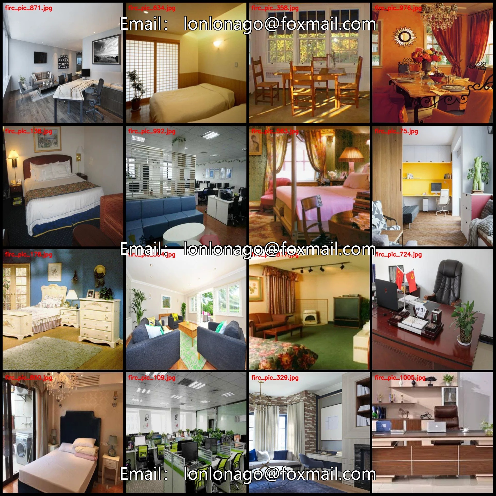
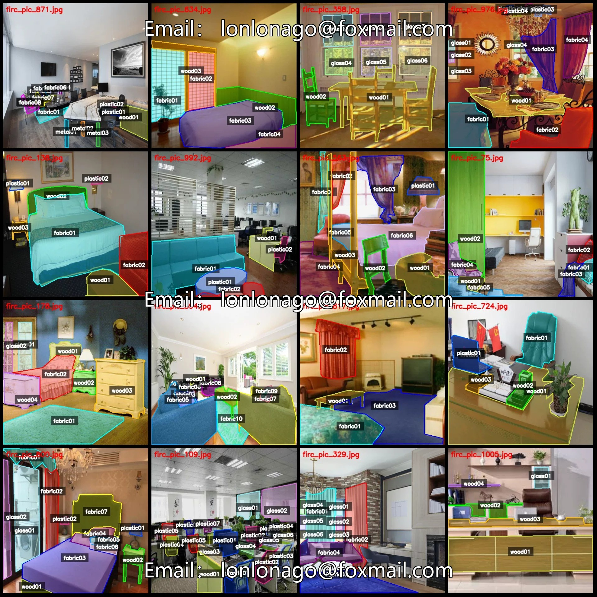
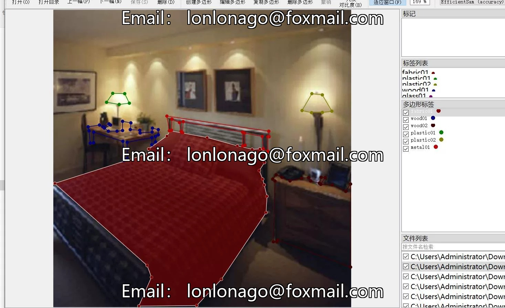
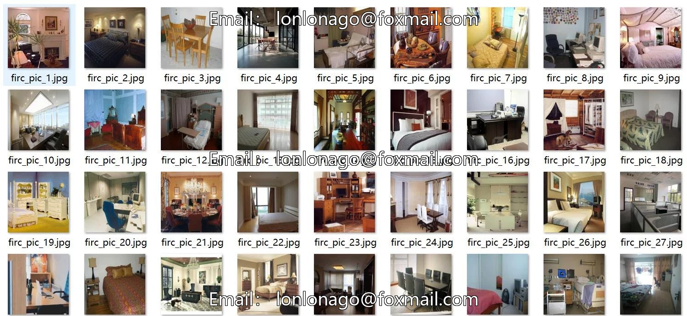
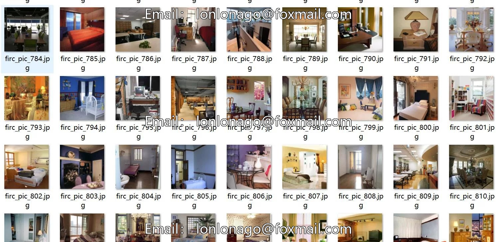

# Indoor flammable object identification and assessment of flammability indoor flammability degree identification segmentation dataset labelm

## Body

Indoor flammable objects identification and assessment of flammability indoors dataset - segmented dataset in labelme format with 1015 images and 85 categories
Warm Reminder: Since the dataset is replicable, please confirm compliance before purchasing.
Dataset format: labelme format (without mask files, only including jpg images and corresponding json files)
Number of images (number of jpg files): 1015
Number of annotations (number of json files): 1015
Number of annotation categories: 85

Label category names: ["fabric01", "fabric02", "fabric03", "fabric04", "fabric05", "fabric06", "fabric07", "fabric08", "fabric09", "fabric10", "fabric11", "fabric12", "fabric13", "fabric14", "fabric15", "fabric16", "fabric17", "fabric18", "glass01", "glass02", "glass03", "glass04", "gla"]

ss05","glass06","glass07","glass08","glass09","glass10","glass11","glass12","glass13","glass14","glass15","glass16","glass17","glass18","glass19","metal01","metal02","metal03","metal04","metal05","metal06","metal07","metal08","metal09","metal10","met

al11","metal12","plastic01","plastic02","plastic03","plastic04","plastic05","plastic06","plastic07","plastic08","plastic09","plastic10","plastic11","plastic12","plastic13","plastic14","plastic15","po","wood01","wood02","wood03","wood04","wood05","woo

d06","wood07","wood08","wood09","wood10","wood11","wood12","wood13","wood14","wood15","wood16","wood17","wood18","wood19","wood20

Number of bounding boxes and image counts per category
fabric01: 879 bounding boxes, 851 images
fabric02: 697 bounding boxes, 685 images
fabric03: 493 bounding boxes, 484 images
fabric04: 348 bounding boxes, 343 images
fabric05: 231 bounding boxes, 230 images
fabric06: 156 bounding boxes, 155 images
fabric07: 108 bounding boxes, 108 images
fabric08: 73 bounding boxes, 73 images
fabric09: 51 bounding boxes, 51 images

fabric10 frame count = 48, occupied image count = 47
fabric11 frame count = 33, occupied image count = 33
fabric12 frame count = 21, occupied image count = 21
fabric13 frame count = 20, occupied image count = 20
fabric14 frame count = 9, occupied image count = 9
fabric15 frame count = 6, occupied image count = 6
fabric16 frame count = 3, occupied image count = 3
fabric17 frame count = 3, occupied image count = 3
fabric18 frame count = 1, occupied image count = 1
glass01 frame count

## Images

## Payment

Here is a pay link on Stripe ( https://buy.stripe.com/3cs8yP7sY87d0vu9AB ). Please contact me lonlonago@foxmail.com after funding $89, and I will send you a complete data files , thank you!

